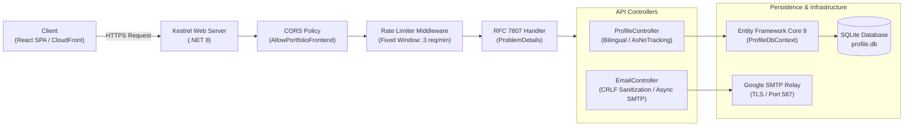

# 🛡️ Axel Linares - Portfolio Backend API (.NET 8)

[](https://dotnet.microsoft.com/)
[](https://dotnet.microsoft.com/apps/aspnet)
[](https://learn.microsoft.com/ef/core/)
[](https://www.sqlite.org/)
[](https://swagger.io/)
[](https://datatracker.ietf.org/doc/html/rfc7807)

*Production-ready, highly secure REST API powering a decoupled modern portfolio ecosystem. Built under Clean Code principles, native .NET 8 Rate Limiting, strict input sanitization, and standardized RFC 7807 problem details.*

---

🌍 **[English](#-english-version)** | 🌎 **[Español](#-versión-en-español)**

---

<a id="english-version"></a>
## 🇺🇸 English Version

### 📌 System Overview & Architectural Purpose

This service constitutes the core backend for a decoupled full-stack portfolio platform. Engineered with **.NET 8 (ASP.NET Core Web API)** and **Entity Framework Core**, it provides high-throughput, low-latency endpoints serving dynamic ATS-compliant CV data (experiences, certifications, and technical projects) with native bilingual content negotiation (`es` / `en`), alongside an abuse-resilient contact notification pipeline.



---

### 🏛️ Engineering & Architecture Highlights (Semi-Senior Level)

1. **Native .NET 8 Rate Limiting (Anti-Abuse & DoS Mitigation):**
   * Configured `FixedWindowRateLimiterOptions` partitioned by client IP address (`RemoteIpAddress` with `X-Forwarded-For` fallback) on sensitive endpoints (`/api/email/send`).
   * Rejections return `429 Too Many Requests` formatted strictly as **RFC 7807 ProblemDetails** to prevent bot spam without service disruption.
2. **AppSec & Input Sanitization (OWASP Compliance):**
   * **CRLF / SMTP Header Injection Defense:** Explicit striping and normalization of `\r` and `\n` characters before constructing email headers (`Subject`, `From`, `ReplyTo`).
   * **Strict DTO Validation:** Data Annotations enforcing length bounds, regex character whitelist, and RFC-compliant email formats.
   * **Zero Information Leakage:** Production error responses never disclose internal exception messages (`ex.Message`) or stack traces.
3. **Resilient Data Seeding & Relational Mapping:**
   * Automated startup synchronization via [`DataSeeder.Initialize`](file:///C:/Proyectos/AxelLinaresApi/Data/DataSeeder.cs) executing `EnsureCreated()` with clean upserting, eliminating manual schema migration overhead for local and cloud container deployments.
   * Complex value conversion (`List<string>`) via `ValueConverter` and `ValueComparer` for relational SQLite compatibility.
4. **High-Performance Querying:**
   * Read-only profile endpoints utilize `.AsNoTracking()` to reduce memory footprint and bypass change tracker overhead.
   * Asynchronous, non-blocking I/O operations (`SendMailAsync`, `FirstOrDefaultAsync`) utilizing `CancellationToken` support throughout the execution pipeline.

---

### 🔌 API Specification & Contracts

#### 1. Retrieve Candidate Profile
* **Endpoint:** `GET /api/profile`
* **Query Parameters:** `lang` (`es` default, `en` optional)
* **Response:** `200 OK` (Bilingual CV Profile Object) | `404 Not Found` (ProblemDetails)

```http
GET /api/profile?lang=en HTTP/1.1
Host: localhost:5139
Accept: application/json
```

#### 2. Send Contact Inquiries
* **Endpoint:** `POST /api/email/send`
* **Rate Limit:** 3 requests per 1-minute window per IP.
* **Payload:**
```json
{
  "name": "Jane Doe",
  "email": "jane.doe@enterprise.com",
  "message": "We reviewed your .NET and QA automation experience and would like to schedule an interview."
}
```

#### Standardized RFC 7807 Error Contract
```json
{
  "type": "https://tools.ietf.org/html/rfc9110#section-15.5.1",
  "title": "One or more validation errors occurred.",
  "status": 400,
  "instance": "POST /api/email/send",
  "errors": {
    "Email": ["El formato del correo electrónico no es válido."],
    "Message": ["El mensaje debe tener entre 10 y 2000 caracteres."]
  },
  "traceId": "0HNPEVQU256BN:00000001"
}
```

---

### 🚀 Getting Started & Local Setup

#### Prerequisites
* [.NET 8 SDK](https://dotnet.microsoft.com/download/dotnet/8.0) (v8.0.x or v9.0.x)
* [Git](https://git-scm.com/)

#### Installation & Execution
```bash
# 1. Clone repository
git clone https://github.com/ElorichV/AxelLinaresApi.git
cd AxelLinaresApi

# 2. Restore dependencies
dotnet restore

# 3. Configure secrets (Development recommended via Secret Manager)
dotnet user-secrets init
dotnet user-secrets set "EmailSettings:SenderEmail" "your-email@gmail.com"
dotnet user-secrets set "EmailSettings:SenderPassword" "your-app-password"

# 4. Build solution
dotnet build --no-incremental

# 5. Run API
dotnet run
```
* **Swagger UI:** `http://localhost:5139/swagger` (accessible in Development environment).
* **Database:** SQLite file `profile.db` will be generated and seeded automatically upon first execution.

---

<a id="versión-en-español"></a>
## 🇲🇽 Versión en Español

### 📌 Resumen del Sistema y Propósito Arquitectónico

Este servicio representa el núcleo backend de una plataforma web desacoplada para un portafolio profesional de alto nivel. Desarrollado con **.NET 8 (ASP.NET Core Web API)** y **Entity Framework Core**, provee endpoints de alto rendimiento y baja latencia para servir información curricular dinámica compatible con sistemas ATS (experiencias laborales, certificaciones y proyectos de software) con negociación bilingüe (`es` / `en`), sumado a un pipeline de contacto protegido contra spam y abusos.

---

### 🏛️ Características Técnicas y Decisiones de Diseño (Nivel Semi-Senior)

1. **Rate Limiting Nativo de .NET 8 (Mitigación de DoS y Spam):**
   * Implementación de middleware con algoritmo **Fixed Window** (`3 peticiones / minuto`) particionado por dirección IP del cliente.
   * Rechazos estandarizados bajo el código HTTP `429 Too Many Requests` formateados con **RFC 7807 (ProblemDetails)**.
2. **Seguridad y Validación Estricta (Estándar OWASP):**
   * **Defensa contra CRLF / SMTP Header Injection:** Sanitización explícita de caracteres `\r` y `\n` antes de la asignación en cabeceras de correo electrónico.
   * **Validación Declarativa de DTOs:** Restricciones de longitud, expresiones regulares anti-XSS y validación de sintaxis de correo electrónico vía Data Annotations.
   * **Cero Fuga de Información Sensible:** Control global de excepciones que previene la exposición de detalles de infraestructura o stack traces en producción.
3. **Persistencia y Seeder Resiliente:**
   * Sincronización automática mediante [`DataSeeder.Initialize`](file:///C:/Proyectos/AxelLinaresApi/Data/DataSeeder.cs), asegurando que los datos de experiencia (Positronica Labs, Sección Amarilla, etc.) y proyectos se mantengan actualizados sin necesidad de migraciones manuales.
   * Manejo de tipos complejos (`List<string>`) mediante `ValueConverter` y `ValueComparer` sobre SQLite.
4. **Optimización de Consultas y Concurrencia:**
   * Lectura de perfil optimizada con `.AsNoTracking()`, reduciendo el consumo de memoria y evitando la sobrecarga del Change Tracker.
   * Operaciones asíncronas de extremo a extremo (`await SendMailAsync(...)`) con soporte de `CancellationToken` para una gestión eficiente del Thread Pool.

---

### 🛠️ Especificación de Endpoints

| Método | Endpoint | Parámetros / Body | Códigos de Respuesta | Descripción |
| :--- | :--- | :--- | :--- | :--- |
| `GET` | `/api/profile` | `?lang=es` o `?lang=en` | `200 OK`, `404 NotFound` | Retorna el perfil profesional completo con traducciones automáticas en memoria. |
| `POST` | `/api/email/send` | `ContactRequest` (JSON) | `200 OK`, `400 BadRequest`, `429 TooManyRequests`, `500 InternalError` | Envía notificaciones de contacto vía SMTP con rate limiting y sanitización activa. |

---

### 🚀 Despliegue e Infraestructura Cloud
* **Backend:** Empaquetado para despliegue en Linux / Windows en **AWS Elastic Beanstalk** o contenedores Docker.
* **Base de Datos:** SQLite autocontenida para portabilidad y bajo costo operativo.
* **CORS:** Política restrictiva preparada para autorizar peticiones desde la CDN de AWS CloudFront (`cv-react-frontend`).

---

### 👨‍💻 Autor & Contacto
* **Desarrollado por:** Axel Alberto Linares Lorrabaquio
* **Rol:** Full-Stack Software Engineer (.NET Backend & QA Automation)
* **LinkedIn:** [Axel Linares](https://www.linkedin.com/in/axel-alberto-linares-lorrabaquio-69a6b31b0)
* **GitHub:** [@ElorichV](https://github.com/ElorichV)
* **Laboratorio:** [Positronica Labs](https://positronicalabs.dev/team)
